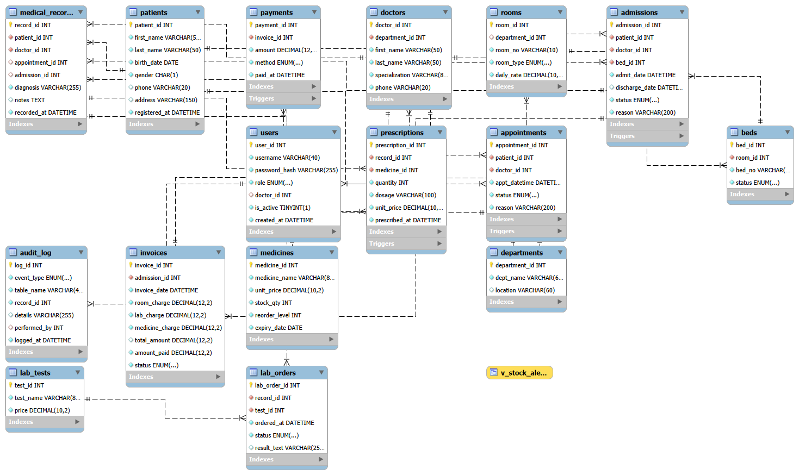

# Hospital Management - DBMS Final Project

A hospital database with patients, appointments, medical records, inpatient admissions with bed control, pharmacy stock, lab tests and billing.

Track: Independent Track. DBMS 1 and SIA are two separate projects. This repository is the DBMS 1 project.

## Group roster and ownership matrix

| Member | GitHub username | Tables | Complete resource | Join report and type | Feature role |
|---|---|---|---|---|---|
| A - [Joanna Joyce Caromayan] | [Joyce_Moycee05] | patients, appointments, medical_records | Patients | R1 Appointment schedule (INNER JOIN) | Core |
| B - [Jerry Mae Callao] | [jerrydevvv] | departments, doctors, users | Doctors | R12 Accounts and linked doctor (LEFT JOIN) | Master data |
| C - [KC Cimafranca] | [camy_ky] | admissions, invoices, payments | Payments | R7 Billing summary (INNER JOIN) | Transactions |
| D - [Mary Aljane Cadano] | [marie-chan] | rooms, beds | Beds | R5 Bed board (RIGHT JOIN), R6 Departments vs rooms (FULL OUTER JOIN via UNION) | Unique feature (rules) |
| E - [Erich Cabugnason] | [erichs333] | medicines, prescriptions, audit_log | Medicines | R11 Audit trail (LEFT JOIN) | Unique feature (workflow, alerts), Audit |
| F - Josh Daligdig | jadaligdig | lab_tests, lab_orders | Lab tests | R4 Never-used lab tests (LEFT JOIN) | Reports |

## Major feature: inpatient flow with automatic bed control and billing

Admit a patient (the bed becomes Occupied), prescribe medicine (stock is checked and deducted), discharge (the bed is freed and the invoice is created), and pay (the invoice moves Unpaid, Partial, Paid). Every step is written to an audit log.

## Database (16 tables)

Run database/hospital_management.sql in MySQL Workbench. It recreates the hospital_db database. It needs MySQL 8.0.16 or newer.

## ER diagram

## How to run the app

1. Install Python and run: pip install -r app/requirements.txt
2. In a Command Prompt, set the password: set DB_PASSWORD=your-mysql-password
3. Run: python app/app.py
4. Open http://127.0.0.1:5000/lab-tests in your browser.

Do not put real passwords in this repository.

## Git workflow

- Nobody commits directly to main. Each member works on their own branch.
- Commit messages start with feat:, fix:, docs: or refactor:.
- Every change goes through a pull request reviewed by a different member.
- Pull requests are merged with a merge commit (no squash).
- Commits are made from our own computers, not the GitHub web editor.